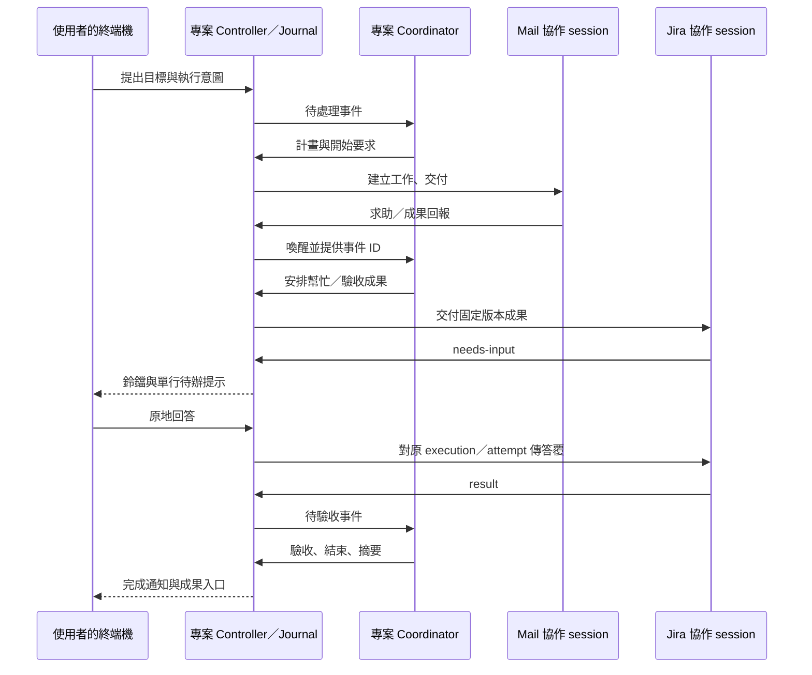

# 專案協作與終端機操作改版 Plan

日期：2026-10-16。狀態：研究與自行 review 後的實作計畫；實作進行中，見下表。

| 工作包 | 進度（`npm test`／`tsc`／`vite build` 通過；**均未實機驗收**） |
| --- | --- |
| P0 | 成員啟動設定（`project-launch.ts`）、Execution 與 notice 型別完成；各 CLI 結構化 adapter 未驗證，仍走 tmux 互動 session |
| P1 | 待辦投影（`project-attention.ts`）、浮層專案卡片、成員小卡、計畫摘要化、coordinator／工作 session 掛專案子列、討論區收合完成；單行背景提示、「稍後」未做 |
| P2 | opt-in 的每任務獨立 session（`handOverIsolated`）完成；controller 單一化、Rust registry、重啟恢復、execution 環境變數未做 |
| P3 | 求助 run 並行（上限 2）、coordinator notice 喚醒完成；`waiting-help`、協助 task 掛原 run、notice ack 指令未做 |
| P4 | 已讀跨視窗同步完成；原生選項原地回答、舊資料收編不需新程式（見 `docs/projects.md`） |
| P5 | 文件已隨各批更新（`docs/projects.md`、`docs/attention.md`）；實機驗收與 `project-verification.md` 未做 |

依據目前工作目錄（含既有未提交變更）、herdr 官方文件與官方網站互動示範。本文提出下一版的調整，不把舊規格的設計當成已完成的功能。既有實機驗收表也仍標示未實測。

## 1. 要完成的使用體驗

使用者平常留在自己的終端機工作。專案在背景安排成員協作，需要使用者時，在目前畫面即可看到並完成動作。進專案後先看到加入的 agent 小卡，點選才看用途、任務、模型、成果及紀錄。

本次需求的完成條件：

1. 成員協作使用獨立工作 session；自動邀請、任務、求助、答覆都不貼進使用者原本的主對話。
2. Coordinator 直接掛在專案下，不出現在「未分組」，不依賴收藏才能重開。
3. 任務交付、求助轉派、成果回報、coordinator 驗收與後續交接可以連續進行；正常流程不需要使用者幫忙轉話或逐步按交付。
4. 開始計畫、回答問題、驗收、核對不確定結果等專案動作，可從任意終端機上的待處理入口操作。
5. 原生 agent 的核准或選擇題，能可靠辨識者可在待處理面板回答；其餘直接定位該工作終端機，無須先進專案頁。
6. 看著 agent 工作不會停止整個專案；人工接管只作用於使用者實際接管的工作 session。

## 2. 現況診斷：不自動的原因

以下是程式路徑確認的問題；未經實機重現的部分不宣稱已重現。

| 問題 | 程式依據 | 對使用者的影響 |
| --- | --- | --- |
| 加入成員就是綁住原本終端機 | `project-control.ts` 的 `instanceKey`／`memberCandidates`，`project-panel.ts` 的 `addMember` | 專案把成員、個人對話與執行工作的位置綁在一起 |
| 協作靠往原對話貼 prompt | `project-delivery.ts` 的 `typeBatch`／`helps`／`greetAll`，`main.ts` 的 `sendPromptToAgent` | 介紹、求助和結果會插入原對話；每次都得等目標 agent 閒置 |
| 「查看」即人工暫停 | `main.ts` 每秒把目前頁籤的所有 leaf 傳給 `setViewing`；`project-hold.ts` 離開並 idle 10 秒才解除 | 只是查看，甚至只看另一個分割，都可能讓需要的輸入停止；解除操作主要在專案頁 |
| 執行中求助無法照 prompt 派工 | `helpPrompt` 要求 `plan submit` 後 `run start {helpId}`；`project-tasks.ts:227` 在已有 active run 時拒絕 `StartRun` | worker 做到一半求助時，coordinator 無法開第二份 run 幫忙 |
| 一般成果缺少 coordinator 喚醒路徑 | `ReceiveReport` 保存成果／改狀態；`project inbox` 只讀人類訊息；pump 處理訊息、答覆、求助與介紹，沒有一般 `result-ready` 通知 | 預設需 coordinator 驗收的步驟可能停在等待，除非它自行查詢或使用者介入 |
| 專案待處理與終端機提示是兩套 | `project-run-view.ts` 的提問、uncertain、驗收；`main.ts` 的 `renderAttention` 讀終端機 attention | 鈴鐺不會完整反映專案待辦；在終端機工作時容易漏掉 |
| 待處理能看選項，不能直接選 | `renderAttention` 的動作只有前往、忽略 | 看到了問題仍需換頁操作 |
| Coordinator 會落入未分組 | 建立 coordinator 走一般 `newSurface`；`renderTabs` 按收藏群組分類，沒有專案歸屬 | 專案已有一列，coordinator 又多一個普通頁籤入口 |
| 首頁資訊沒有逐層展開 | `project-panel.ts` 的 `paint` 同時畫所有成員、完整 run 與討論；`renderCard` 常駐模型輸入、握手與多個按鈕 | 成員卡片變成設定表，難以掃描現況 |
| 卡片「就緒」只代表綁定與 hello | `project-prompts.ts` 的 `memberStatus` | 不能直接看出 working、blocked、待驗收；也不能把它當可立即收任務的訊號 |
| 執行與視窗生命週期耦合 | delivery 在各視窗前端跑；online 依本視窗 surfaces；coordinator 自動啟動在 panel 內 | 關閉持有視窗後，tmux 仍可能活著，但專案失去觀測與推進入口 |

應沿用的基礎：純 TS `decide`／`reduce`、journal revision CAS、action/report 去重、attempt 識別、成果快照、輸入前先記錄、輸入結果不明時不盲目重送。主要工作是補上隔離、喚醒與操作動線。

## 3. herdr 參考結果

研究對象是 [herdr 官方專案](https://github.com/herdrdev/herdr) 與 [herdr.dev](https://herdr.dev/)，不是搜尋結果中的其他 fork 或另行開發的 web/native client。已在官方網站示範點選 blocked agent，確認小型側欄列可以直接切到它的終端機；這是網站示範，未安裝 herdr 實測。

| 可參考的做法 | HiGhostty 的採用方式 |
| --- | --- |
| 小型 agent 列搭配實際終端機，狀態向 tab／workspace 彙總 | 小卡與專案列顯示需要人、工作中、已完成未讀；詳細內容按需開啟 |
| layout、pane、agent 各有清楚責任 | 分開「成員身分」「工作 session」「顯示它的終端機」；移動／關閉顯示入口不等於結束工作 |
| start、prompt、wait、read 可組成協作流程 | HiGhostty 補齊工作生命週期與結構化成果驅動的喚醒，避免靠 agent 記得反覆查詢 |
| 狀態變化可訂閱，server 持有程序 | 前端訂閱執行狀態；scheduler 與 runtime 不依專案頁是否開著 |

上述依據：[概念](https://herdr.dev/docs/concepts/)、[agent 狀態與彙總](https://herdr.dev/docs/agents/)、[agent automation](https://herdr.dev/docs/agent-automation/)、[Socket API](https://herdr.dev/docs/socket-api/)。

herdr 官方流程會建立獨立 pane 裡的 agent。文件沒有承諾能從外部控制所有 CLI 的原生子 agent；跨產品的子 agent 管理仍需各自接入。idle／done 也只描述 agent 狀態，不能證明任務成果正確。以下執行隔離與驗收設計是 HiGhostty 的方案。

## 4. 子 agent 的選擇：隔離工作與個人主對話

### 4.1 明確區分兩件事

- **CLI 原生子 agent**：由 Claude／Codex 等主 agent 呼叫自己的委派工具，生命週期及回傳方式由該 CLI 管理。
- **專案的獨立工作 session**：HiGhostty 依某位成員的啟動設定建立另一段對話，專門接受專案工作。它可使用該 CLI 的原生子 agent，但本身不一定是 CLI 認定的原生子 agent。

採用第二種作為跨 CLI 的基礎，再接入有可靠控制介面的原生子 agent。產品上稱「協作工作」，詳情列出實際執行方式，避免讓使用者誤以為另一個 CLI 程序就是既有主對話的子 agent。

| 選項 | 評估 |
| --- | --- |
| 繼續對每個主對話送「請開子 agent」 | 仍需打斷主對話、等它閒置，無法完成本次需求 |
| 所有工作都變成 coordinator 的原生子 agent | 不會自動取得 Mail／Jira 等其他成員各自的 cwd、設定、skills 與 MCP；不能據此宣稱保留原成員能力 |
| 每個成員提供啟動設定，專案建立獨立工作 session | 作為基礎方案；原對話可持續與使用者工作，專案有自己的可靠控制入口 |

### 4.2 已查證的接入能力

| CLI | 已確認的官方能力 | 本計畫的接入方式與限制 |
| --- | --- | --- |
| Codex | 原生 subagents；App Server 提供 thread／turn、事件及核准請求；`exec --json` 有結構化事件 | 優先驗證 App Server 的獨立 thread 與核准流程。`exec` 只用於適合預先設定權限的工作，不假設能互動核准 |
| Claude Code | 原生 subagents；`--agent` 可讓新 session 採指定 agent；支援 print／stream-json | 優先驗證獨立 session 的設定載入與可回覆核准的 host 介面；只有 stdout 串流不足以解決核准 |
| Copilot CLI | custom agent、獨立 context 的 subagent、`--agent ... --prompt ...` | 首版可用獨立互動終端機工作 session；程式化核准與恢復另經能力驗證 |
| Gemini CLI | 原生 subagents 與 headless JSON／stream-json | 同樣先支援獨立互動工作 session；本機未找到 `gemini`，不能宣稱已驗證 |

官方依據：[Codex subagents](https://learn.chatgpt.com/docs/agent-configuration/subagents)、[Codex App Server](https://learn.chatgpt.com/docs/app-server)、[Codex 非互動模式](https://learn.chatgpt.com/docs/non-interactive-mode)、[Claude subagents](https://code.claude.com/docs/en/sub-agents)、[Copilot custom agents](https://docs.github.com/en/copilot/how-tos/copilot-cli/use-copilot-cli/invoke-custom-agents)、[Gemini subagents](https://geminicli.com/docs/core/subagents/)、[Gemini headless](https://geminicli.com/docs/cli/headless/)。另已讀本機 codex／claude／copilot 的 `--help`，未啟動新 agent 或消耗模型用量。

沒有通過結構化介面驗證的 CLI，使用獨立 tmux 互動 session，保留原生核准畫面及現有觀測方式。無法重建成員設定者顯示「需要設定協作啟動方式」，不自動改去對主對話貼訊息。

### 4.3 成員的啟動設定

加入專案時取得可供獨立啟動的設定：agent 種類、可執行檔與 argv、原成員 cwd、模型／profile、必要的設定路徑。加入來源可為開啟中的成員或收藏，但之後可獨立存在。

- cwd 預設採該成員原本的目錄。例如 Jira 成員沿用其工具專案目錄，不一律改成 HiGhostty 專案根目錄。
- 協作 session 沿原 CLI 正常方式讀取 skills、MCP 與設定；用能力檢查確認實際可用工具。新 context 不會自動擁有舊對話記憶，額外上下文必須明確提供摘要或成果。
- 啟動參數分類保存；排除指向個人主 session 的 resume／continue ID。不要直接重放整條命令而接回主對話，也不能以目前簡單空白切割解析任意 wrapper。
- 必須明確設定的 wrapper／profile 提供一次設定入口；不能只憑命令名稱猜測它的環境。
- 核准規則沿 CLI 設定運作；自動協作不以新增 bypass 旗標達成。
- 建立工作 session 後才做 hello。停止對個人主終端機自動邀請介紹或要求復誦。
- 模型在新工作 session 啟動時套用；停止為派工往原主對話輸入 `/model`。

## 5. UI 與操作動線

### 5.1 專案導覽與 Coordinator

```text
專案
  ▾ GSS 日常                  2 需要你
      Coordinator             協調中
      Mail 的協作工作         讀取中
      Jira 的協作工作         等待回答

工作區
  未分組／既有收藏群組
      使用者自己的終端機…
```

- 點專案名稱開總覽；展開箭頭只展開子列，不切換主內容。
- Coordinator 固定為專案的子項，其啟動、設定與恢復資料由專案管理，不建立收藏。
- 工作子列按需展開，只列有活動的協作工作；完成工作收進紀錄，避免側欄越來越長。
- 普通 worker 的個人終端機仍留在原工作區位置；協作子 session 歸專案。
- 歸屬用明確的 projectId／memberId／executionId。不能用現有 `tab.coordinator` 布林判斷角色，因為它也用於一般成員的加入與啟動限制。
- 專案管理的終端機從未分組與收藏群組列表排除；以同一份「可見導覽順序」產生點選和 ⌘1～⌘9 對應，避免快捷鍵選到隱藏項目。

### 5.2 首頁只放小卡

```text
GSS 日常                     2 需要你處理    [查看]

[● Coordinator  協調中] [● Mail  工作中] [! Jira  等待回答]

目前工作：整理來信並建立待辦   1/3 完成
[查看計畫] [成果] [與 Coordinator 討論]
```

- 成員小卡初始只放名稱、角色／agent 種類、狀態與一行目前工作。約兩至三行，狀態用文字搭配符號，不只靠顏色。
- 點小卡開第二層詳細內容：用途、目前工作、結果、模型、啟動設定、連線／握手、移除等。首頁不常駐輸入欄。
- 離線成員仍保留小卡，避免讓使用者以為已被移除；已結束的工作不新增永久成員卡。
- 計畫與任務先顯示摘要與進度，詳細步驟、完成條件、attempt 歷史點開才載入。
- 討論區預設收合；保留入口與未讀數。agent 之間的求助、協調及回報收進活動紀錄，人類討論只顯示與人有關的提問及摘要。
- 增量更新卡片；不因每秒狀態變化重建全部表單。選取、草稿、捲動、展開與焦點以 ID 保存。
- 窄視窗的詳情改成可返回的子頁，維持相同資訊層次。

### 5.3 在任何終端機處理專案動作

沿用既有鈴鐺與 `attention-drop.ts`，加入共用的專案待辦來源；專案頁和浮層使用同一組 actions。

| 需要人的事項 | 浮層內可直接完成的操作 |
| --- | --- |
| 計畫待開始 | 展開目標與範圍，開始執行 |
| worker 的業務問題 | 填答覆／選項並送出；顯示等待送達、已送達、繼續處理 |
| 明確指定由人驗收的成果 | 展開成果與條件，通過或填意見退回 |
| 派送／恢復結果不確定 | 先看執行證據，再核對未收到、正在做或失敗 |
| 人工接管中的工作 | 交回專案；只影響該 execution |
| 支援結構化核准的工作 session | 顯示該 provider 的原問題與選項，回覆原 request ID |
| 高信心且有已驗證按鍵映射的終端機選單 | 點原選項，送出前重新辨識同一提示與執行身分 |
| 登入、密碼、低信心提示或未知選單 | 直接開正確工作終端機，由使用者操作 |

背景出現新的未解待辦時，在 workspace 終端機矩形之外顯示單行提示，例如「GSS 日常・Jira 需要選擇類型 [處理]」；鈴鐺有數字，側欄收合也能看到。最多常駐一行，其他合併為數量；不自動展開浮層、不搶焦點。

「需要使用者」與「等待 coordinator 驗收」分開：後者先喚醒 coordinator，不把每筆內部驗收變成人類待辦。只有真的需要使用者、執行不確定、或協調長期無進展才升級提示。

生命週期分為未讀、已看、稍後、已解決。查看或關閉浮層只改已讀；不能因看過某終端機而消除尚未解決的專案問題。「全部清除」只作用於可清除的通知，不批次解決問題或通過核准。

原生終端選項送出前必須重新驗證 execution／generation、prompt 指紋、目前選項及當前 blocked 狀態。任何不符就更新卡片請使用者重新選；送出後鎖住，等畫面變化再顯示結果，不盲目補 Enter。低信心結果只提供前往。跨視窗按鈕也走唯一執行 owner 去重。

單行提示推開終端機 rect；浮層繼續使用既有 `overlay-cutout`，與片段面板互斥。詳情 drawer 是 `#terminals` 的兄弟並參與版面切分。這些都必須納入 files／preview 的幾何計算，不能只提高 HTML z-index。

## 6. 協作流程：補齊每一步的接續



### 6.1 持久的協調收件匣

新增型別化 notice：人類訊息、成員求助、成果待驗收、失敗／拒絕、取消回報、執行恢復。notice 和來源狀態變化在同一個 journal transaction 保存；以來源事件／task／attempt 建立固定 ID 去重。

- `project inbox` 保留既有人類訊息格式；新增有版本的協調事件讀取與 ack 指令，避免直接改壞既有 CLI 消費者。
- 人類訊息的序號、協調事件的游標及已讀資訊分開，不能共用 `messages.length` 或某個全域 revision 當消費完成。
- notice 的「喚醒已送出」和「內容已處理」分開保存。coordinator 執行驗收、回覆或有原因的處理結果，才完成對應 notice。
- 新事件 commit 後觸發 pump；低頻補掃恢復漏失事件。每次喚醒合併一批 ID，內文用 ctl 讀取。
- busy 時排隊，blocked 時建立人的待辦；輸入開始後失敗仍走 uncertain。沒有回覆時先讀取／核對，不反覆貼同一份 prompt。
- 對停在 `result-ready` 的工作，自動喚醒 coordinator。驗收通過後下游排入佇列，不要求使用者轉送成果。
- 結構化 provider 的 turn 完成或程序 exit 只代表執行狀態；工作仍以有效的 result 與既有完成條件驗收。

### 6.2 執行中求助掛在原工作下

新增 `HelpWorkRequested`／`HelpWorkCompleted` 等 action/event，保存 parentTaskId、parentAttemptId、requesterExecutionId、helpId 與負責成員。Coordinator 可把同範圍的協助工作加入原 run，不呼叫第二次 `StartRun`。

- 主計畫版本維持凍結；協助 task 自帶不可變的工作規格快照。`stepOf`／payload／驗收不能再只靠 `plan.steps` 找動態工作。
- 保留每專案一個頂層 active run；協助 task 也納入 run 完成判定。主流程與協助工作的進度分開顯示，避免分母突然膨脹而看不懂。
- 沒有 active run 的獨立求助，仍可建立以 helpId 為來源的頂層 run。來自主終端機的這種主動求助，其結果預設放待辦／成果入口，不自動貼回主對話。
- 增加明確的 `waiting-help` 任務狀態；求助者結束當前 turn 等結果，保留 execution 與成員占用，不自動完成或改派。結果只送回原 requesterExecutionId 與 attempt，不送到「這位成員目前最新的某個 session」。
- 一個 helpId 可關聯多個協助 task，但只建立一次有效的派工集合。明確區分「已安排」「有結果」「無法協助」，`help answer` 不代表成果完成。
- Coordinator 不把工作轉派回正在等自己的祖先 task；檢查求助依賴循環。初始限制協助深度 2、每專案同時運算 2 個 worker 工作，之後依設定調整。已結束當前 turn 的 `waiting-help` 不占運算名額，協助工作優先於無關的新工作，避免兩個父工作占滿名額卻都在等 helper。等待中的 session 數量另設上限，超過時顯示明確原因。
- 父 attempt 已取消、替換或結束時，保留晚到成果但不自動喚醒新 attempt。取消父工作要處理仍在執行的協助工作，不假裝已停止。
- 超出原要求的工作交回使用者；原範圍內可自動安排與驗收，沿用既有執行意圖紀錄。

### 6.3 查看與接管

獨立工作 session 的詳情預設為觀察。使用者自己的主終端機是否正在使用，不列為該協作 execution 的 hold 條件。

開啟協作終端機的互動控制前，原子取得人工接管權；接管成功才交鍵盤焦點及允許輸入，先排除正在提交的自動輸入。交回後重新讀取狀態再投遞。UI 必須在可見位置提供「人工接管中／交回專案」，不能要求回總覽找按鈕。

若某個 terminal adapter 暫時不能區分觀察與互動，進入該協作終端機即顯示並取得接管，離開後再安靜恢復；只暫停該 execution，其他成員照常進行。

## 7. 執行架構與資料合約

### 7.1 三層身分

| 層次 | 保存內容 | 責任 |
| --- | --- | --- |
| Member | 名稱、用途、agent 種類、工作啟動設定 | 長期加入專案的合作對象；不要求個人終端機開著 |
| Execution | project/member/task/attempt、generation、provider session/thread ID、狀態 | 一次工作的執行身分；答覆與回報必須精確歸屬 |
| Terminal attachment | window/tab/surface、對應 execution | 查看或人工操作入口；可關閉、重建，不重新建立工作 |

每個 task attempt 建立一個 execution；同 attempt 的答覆、修改意見與協助結果續用該 session。Coordinator 是專案長期管理的 execution，不是普通收藏。原個人終端機只保留可選的來源關聯。

### 7.2 唯一 Controller 與 runtime

- 純任務、求助、notice、待辦規則繼續放 TS 的 `decide`／`reduce`；Rust 不重寫業務規則。
- App 維持一個不依賴可見專案頁的 controller WebView。所有一般視窗是狀態訂閱者與 action 發送者；不各自啟動 coordinator 或執行獨立 pump。
- Rust 持有 execution registry、程序／tmux 資訊、controller epoch 與 effect claim，負責啟動／接續／輸入等機械操作。effect claim 綁 execution＋generation；journal commit 後才執行。
- Controller 崩潰或重建時重新 replay，再核對 runtime；不以 lease 過期就重建 task。多視窗不能各自對同 execution 送輸入。
- 互動 terminal adapter 使用受管理的 tmux session；有 surface 時沿用原生 scan，沒有 attachment 時從 tmux 取得前景行程與畫面。它必須能在開啟詳情時 attach 同一 session。
- Provider adapter 對外只提供啟動、觀測、提交、回覆問題、續接和停止能力；能力不支援就明確回報，不能轉成對主終端機輸入。
- 原本每個視窗內的一條 `exclusive` 改為每個 execution 序列化；專案層管理併發上限。工作 session 的串流／長等待不占住其他成員的輸入佇列。同一成員預設一次一個協作工作；寫入同一目錄的工作預設序列化，只有已明確隔離工作樹或寫入範圍才平行。
- 關閉一般視窗、收合側欄、切專案不停止協作。真正結束 App 後停止調度；tmux 程序可繼續，重新啟動後核對並恢復追蹤。首版不承諾 App 已退出時還會自動派下一個工作，也不為此引入全新的常駐系統服務。

暫停只停止後續交付；取消進行中的工作保存取消要求並通知原 execution，不以 kill 或 Ctrl+C 假裝已取消。若 helper 被父工作占住的寫入資源擋住，要明確交接可移交資源或回報依賴衝突，不能讓它無限等候。已發生的外部效果仍保存並核對。

### 7.3 ctl 與回報路由

保留同 UID socket、0600 與 off／readonly／full 模式。新 execution 的 caller 由受管理 runtime 對應；不能因 stdin 自填 memberId 就讓回報變成另一個成員。

- 新 terminal 工作 session 用新的 tmux session 與對應環境；程式化 session 用 registry 綁定。`HIGHOSTTY_*` 與 CLI request 如需新增 execution ID，需一起更新注入、解析與跨視窗路由。
- `task get`／`task report` 同時核對 member、task、attempt、execution generation；同一位成員的另一個工作不能回報這一份。
- 新協調事件 ack／求助派工指令放 `control.ts` 的 OPS，輸入解析放 `project-control.ts`；狀態變更指令標 `write: true`。
- 對一般視窗仍維持每個 `control-request` 都回 owner／part／none；專案 runtime 呼叫交由 controller claim，不能因沒有可見 surface 而拖到逾時。
- 人在浮層按下動作走 user action；agent 發起的自動寫入遵守 full 模式。切回 readonly 時停止新的自動寫入，並顯示具體原因。

## 8. 待辦模型與通知規則

共用投影放新的 DOM-free `project-attention.ts`：由 journal、runtime、讀取狀態推導 `ActionItem`，首頁、側欄、鈴鐺與浮層讀同一份。

ActionItem 至少包括穩定 ID、project/member/task/attempt/execution、kind、來源版本、摘要、可用動作。業務問題與 uncertainty 來自 journal；terminal blocked 來自即時 runtime，重啟後重觀測，避免把舊畫面當新待辦。

- 同一問題跨專案列、成員卡與鈴鐺只算一次；終端 blocked 與已知 provider approval 有對應時合併。
- 優先顯示核准／提問／結果不確定，再顯示需人驗收；普通 progress 只更新狀態。
- seen／snoozed 是使用者的本機資訊，可跨視窗同步；resolved 由有效回答或狀態轉移決定。
- 問題已替換或 attempt 已更新時，舊動作在 controller 被拒，保留草稿並顯示最新問題。兩個視窗同時按只接受一個 actionId。
- 新待辦最多一次提醒；讀過但未處理保留 badge。持續無進展的提醒去重與節流，不每秒產生新通知。
- App 不在前景時沿用／補接原生通知與 Dock 提示；使用者返回後仍看得到未解項目。通知點擊定位待辦，不自動執行選項。

## 9. 遷移與恢復

1. 沿用單一 journal，增加具版本的新事件；舊事件 replay 可還原，禁止直接改寫舊事件。
2. 舊 member 的主終端綁定保留為來源；從既有收藏或開啟頁籤補出啟動設定。資料不足時出現一次設定待辦，不能硬用 `agentKind` 重建一個缺工具的 session。
3. 已送出的舊 attempt 保持綁定原終端機直到結束或明確核對，不能搬進新 session 後重做。舊主對話不再接收新的自動介紹或任務；無法投遞的舊答覆改列待辦供使用者操作。
4. 舊 coordinator 以明確的專案 member/binding 辨識並收編，在側欄移到專案下；先 adopt 現有 session，不因舊版缺 metadata 就再開一份。
5. runtime metadata 保存在本機資料目錄，包含 projectId、executionId、generation、provider ID／tmux session；不將憑證或 provider 私有完整設定複製到 journal。收藏不是 execution 的唯一來源。
6. App 重啟時先還原 journal，再核對實際程序與已知 session；尚未開始輸入的可重新排程，開始過但結果不明的維持 uncertain。恢復同一 execution，不能只看找不到 surface 就重啟工作。
7. 完成的 execution 保存結果與必要診斷，終端 attachment 可關閉。進行中或結果不確定的 session 不自動清理；保留策略與停止操作須可見。

## 10. 實作順序與逐批完成條件

| 順序 | 工作包 | 主要檔案 | 交付門檻 |
| --- | --- | --- | --- |
| P0 | 固定啟動設定、execution、notice、ActionItem 合約；驗證 provider 能力 | `project-types.ts`、新 runtime/adapter 型別；更新實作規格 | 用兩個既有成員設定確認能獨立啟動、讀到所需工具、保留核准方式；寫清各 CLI 的可用／不可用能力，不執行實際外部寫入 |
| P1 | 小卡、詳情、coordinator 專案子列、全域待辦 | `project-panel.ts`、`project-run-view.ts`、`attention-drop.ts`、`main.ts`、`style.css`、新 `project-attention.ts` | 在任意終端機能回答專案問題、開始計畫、看成果及驗收；首頁無常駐模型表單；coordinator 不重複列在未分組 |
| P2 | 獨立工作 session、controller/runtime、精確 caller 路由 | 新 `project-controller.ts`、`project-runtime.ts`／terminal adapter、`src-tauri/src/project_runtime.rs`；`project-delivery.ts`、`control.*`、`tmux.ts` | 主終端機忙碌、正在輸入或關著，都可另開協作工作；主對話無自動輸入；關閉顯示窗口仍能追蹤同一工作；兩視窗不重複啟動 |
| P3 | 持久協調收件匣、動態求助工作、成果驗收後接續 | `projects.ts`、`project-tasks.ts`、`project-schedule.ts`、`project-prompts.ts`、`project-ctl.ts`、`project-control.ts` | 執行中 A 求助 B 不被 active-run 限制卡住；B 成果喚醒 coordinator，通過後回到 A 原 attempt；一般成果也可自動驗收接下游 |
| P4 | 原生選項原地回答、跨視窗通知、遷移／恢復 | `attention.ts`、`prompt-rules.*`、待辦 actions、runtime、`main.ts`、`src-tauri/src/main.rs` | 已驗證選單能從別的終端機回答；過期問題不送鍵；舊 session 可收編；重開不重做已開始的輸入 |
| P5 | 完整體驗驗收與文件同步 | `tests/project*.test.mjs`、`tests/control.test.mjs`、相關 native/runtime 測試；`docs/projects.md`、`project-implementation.md`、`project-verification.md`、`skills/highostty/SKILL.md`、locales | 下列情境全過，debug／release 各完成原生操作驗收；紀錄實際完成和未完成項 |

P1 可先改善現在的操作成本；完整的自動協作需 P2、P3 與恢復路徑一起完成。結構化 provider adapter 按能力驗證逐一啟用，不等待四家全數支援才提供獨立 terminal session。

新增 UI 字串同步英文與繁中，以 `t()`／`data-i18n*` 顯示；純邏輯錯誤保持結構化，顯示時翻譯。實作前依碰到的區域閱讀 keyboard-input、window-drag、attention、snippet-palette、tmux、agent-control、preview、i18n 等文件。這份計畫不視為原生驗收完成。

## 11. 驗收情境

| 情境 | 必須看到 |
| --- | --- |
| 主對話正在處理別的工作 | 專案建立獨立 execution；原輸入框、對話與模型不被改動 |
| 主對話根本沒開 | 已有有效啟動設定的成員仍可參與；不用先開收藏 |
| 使用者連續停留在主終端機 | 其他協作工作持續，不因 `setViewing` 全部 hold |
| 執行中 worker A 求助 B | 原 run 內建立協助 task，無第二次 `StartRun`；B 結果回到原 A execution，A 可繼續 |
| 兩個父工作都等 helper | 等待中的父 turn 不占運算名額；helper 可啟動，或清楚指出成員／寫入資源衝突，不靜默死等 |
| worker 交成果後回到 idle | 有 coordinator notice；以成果驗收決定下游，不把 idle 當成功 |
| Coordinator 正忙／等核准 | 事件排隊；核准進全域待辦；處理後繼續，不丟失通知或重貼 |
| 使用者從另一個專案的終端機回答 | 原問題收到答覆，原終端機不切換；浮層收起後焦點回原處 |
| 問題已被另一個視窗回答／替換 | 舊按鈕失效並顯示新狀態，不送舊選項 |
| 原生高信心選單 | 原地選擇只回到同 execution 同提示；無映射／低信心只提供直接前往 |
| 未讀／已讀／稍後 | 看過不算解決；未解 badge 保留，同一件事不重複狂跳 |
| 成員專屬工具與上下文 | 使用原成員 cwd／profile；缺工具會報明確原因，不以另一位 agent 冒充 |
| 兩個視窗同時派工或同時啟動 coordinator | 只有一份有效 execution／effect，另一邊追蹤同一結果 |
| 貼上後、Enter 前 crash | 重啟後 uncertain；不補 Enter、不重送、不重建工作 |
| 任務／求助結果晚到 | 舊 attempt 留紀錄，不投進新 attempt／個人主對話 |
| 舊專案升級 | 現有 coordinator 收編，不多開；舊進行中工作不被搬走；資料缺少才要求補設定 |
| 窄視窗、切語系、輸入法 | 小卡與詳情可用；輸入中更新不丟草稿；組字 Enter 不送出 |
| files／preview／snippets／拖曳 | 原生 rect、cutout、焦點與視窗拖曳正常，關浮層可取回完整終端操作 |
| 真正 Mail → Jira | 原地回答必要問題，成果可追到來源；已要求執行的範圍內能自動交接，不需人轉話 |

## 12. 寫 Plan 前的自行 Review 結果

| 重新檢查的假設 | Review 後採用的決策 |
| --- | --- |
| 改短卡片就能讓協作順暢 | 同時處理工作隔離、成果喚醒、執行中求助；UI 是其中一部分 |
| 任一 coordinator 的子 agent 都能代替現有成員 | 成員保有自己的啟動設定及工具；跨 CLI 用獨立工作 session，原生 subagent 是 provider 能力 |
| 可以沿舊求助 prompt 再開一個 run | 已確認被單一 active run 規則拒絕；改為原 run 下的動態協助工作與規格快照 |
| 有 report 指令就代表 coordinator 會知道結果 | 明確補持久 notice、喚醒及處理完成狀態，不能只依 agent 自行輪詢 |
| 把 manual hold 移除就能更自動 | 主對話隔離後，只對協作 execution 實施接管；輸入權須原子切換 |
| 把 coordinator 從列表隱藏就完成歸屬 | 啟動、恢復、關閉與快捷鍵都改採專案 ownership，收藏不承擔 runtime 身分 |
| 任何終端畫面的文字選項都能變成按鈕 | 只開啟有驗證映射的高信心選項；送出前核對活體狀態，未知畫面直接前往 |
| 使用者看過終端機即可清掉待辦 | 專案問題以回答／狀態轉移解決，已讀另存；原生 blocked 重新觀測 |
| 關掉視窗等於工作離線，可以重新啟動 | attachment 與 execution 分離；先核對程序／tmux，不重做工作 |
| 背景執行代表退出 App 仍會持續協調 | 首版範圍明確為 App 存活時調度；退出後 tmux 可存活，重開核對恢復 |
| 一個全域佇列有助於所有協作 | 每 execution 序列化並限制總併發，避免一次長等待阻塞其他成員 |
| 把等待 helper 的父工作算入運算上限 | 區分等待中的 session 與實際運算；優先處理協助工作，另檢查成員及寫入資源的依賴衝突 |

本次產出是此計畫文件；沒有變更執行程式，也沒有執行測試或宣稱已完成端到端驗收。
